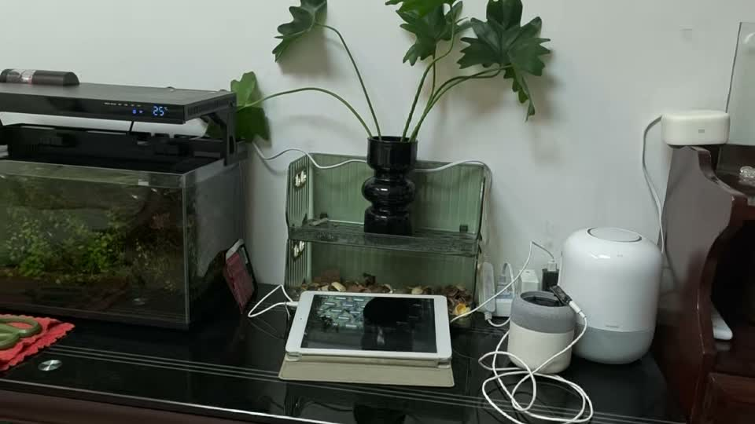
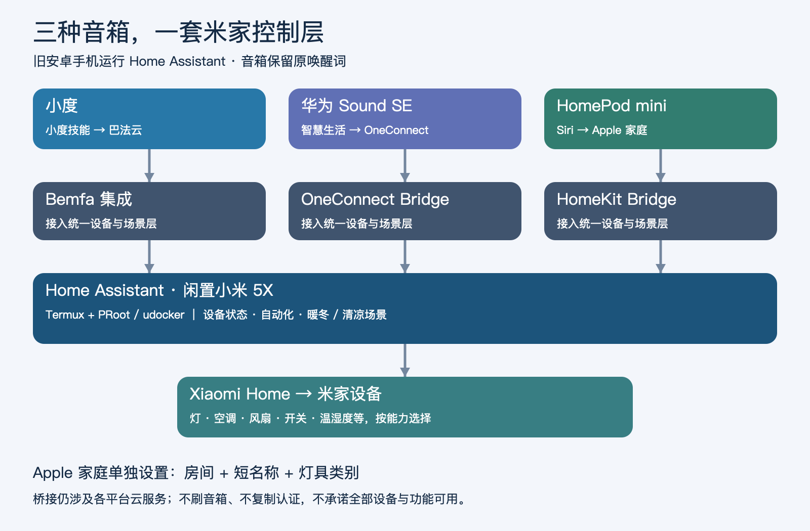
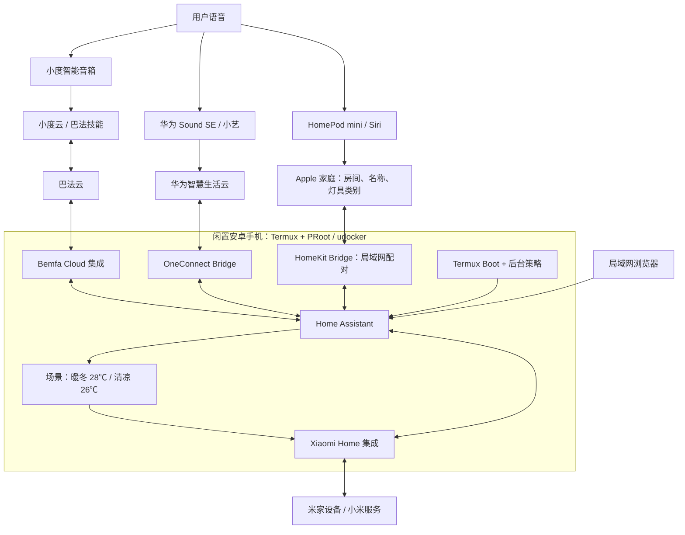
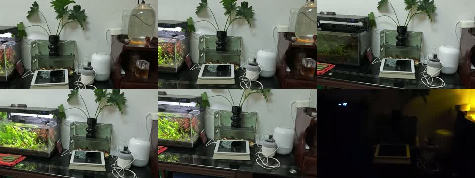

# 旧手机 + Home Assistant：小度 / 华为 Sound SE / HomePod mini 控制米家

把闲置 Android 手机变成家庭桥接主机，让小度、华为 Sound SE 和 HomePod mini 控制米家设备。无需刷音箱、无需替换 Android。项目提供真实部署经验、Agent 复现 prompt、运行脚本、兼容补丁及实拍演示。

> 这是已验证案例的可复现资料包，不是 clone 后无需授权即可运行的一键安装器。每个家庭仍需自己的账号授权、设备映射和硬件验证。音乐投放尚未实现。



[观看原始实拍视频（22 秒，含音轨）](docs/media/demo.mp4) · [完整复现步骤](docs/REPRODUCE.md) · [Agent Prompt](prompts/REPRODUCE.md) · [已知问题](docs/KNOWN_ISSUES.md)

## 实践文章

[知乎：一台闲置小米 5X，让小度、华为 Sound SE 和 HomePod mini 都能控制米家](https://zhuanlan.zhihu.com/p/2102867147277996560)

## 系统架构





控制链路仍依赖对应云服务。HA 是统一设备与自动化层，OneConnect/Bemfa 是语音平台桥接层；不会复制小爱音箱身份或改变原音箱唤醒词。

## 已完成与验证边界

| 功能 | 结果 |
|---|---|
| 小米 5X 无 root 运行 HA | 完成，局域网访问与手机重启自启由用户验证 |
| Xiaomi Home 接入一个家庭 | 24 台源设备；实体数远多于设备数，不等于全部可语音控制 |
| 小度 → 巴法 → HA | 虚拟开关、真实客厅灯、客厅湿度查询已实测 |
| 华为 Sound SE → OneConnect → HA | 虚拟开关、真实客厅灯已实测；服务重启后恢复 |
| Huawei 暖冬 | 用户语音验证成功，客厅制热 28℃ |
| Huawei 清凉 | 已配置制冷 26℃，未做实物验证 |
| 批量映射 | 案例为 21 个真实控制入口 + 1 测试 + 2 场景；没有逐个实物验收 |
| HomePod mini → HomeKit Bridge → HA | 28 个实体已生成配件；虚拟开关、真实客厅灯已实测 |
| Siri 按房间关灯 | 客厅三盏灯同时关闭，其他房间不受影响，用户确认通过 |
| 免费音乐 / DLNA | 仅研究，未部署，不列为已完成 |

## Apple 家庭与房间管理

新增完整指南：[HomePod mini 接入与按房间控制](docs/HOMEKIT.md)。HA 房间不会自动同步到 Apple 家庭，必须在家庭 App 中分房间；开关形式接入的灯需要设置“显示为：灯”。本案例 HomePod 位于书房。

## 快速开始：让 Agent 带你复现

```sh
git clone https://github.com/muziyongshixin/smart-speaker-ha-bridge.git
cd smart-speaker-ha-bridge
```

把目录交给有本地终端和设备操作能力的 Agent，然后复制 [prompts/REPRODUCE.md](prompts/REPRODUCE.md)。Agent 应先盘点设备，再按阶段部署；账号登录、授权和物理确认仍由你完成。请不要把私人聊天记录或 HA 整机备份当作配置模板上传。

只想了解原理可先看架构图；准备部署请从 [完整步骤](docs/REPRODUCE.md) 的第 0 阶段开始。手机方案需要处理 Android 权限与后台限制，已有 Linux/NAS/HAOS 的用户可跳过手机部署，直接复现集成层。

## 示例口令

- 小度小度，打开客厅吸顶灯。
- 小度小度，客厅湿度是多少？
- 小艺小艺，打开客厅吸顶灯。
- 小艺小艺，打开暖冬。
- 小艺小艺，打开清凉。（已配置，未实测）
- 小艺小艺，关闭客厅空调电源。
- 嘿 Siri，关闭客厅所有的灯。（客厅吸顶灯、氛围灯、鱼缸灯均关闭；其他房间未受影响，已实测）

“打开客厅制热”曾被小艺识别成原生空调模式命令并失败；改名“暖冬”后成功。普通空调映射只提供电源控制，温度与模式由 HA 场景组合完成。

## 图文与实拍



视频由部署者提供，画面可见家庭设备和灯光变化。它是补充演示，不代表表格里每个功能均有视频证据；该帧序列未独立转写音轨或逐条核对语音指令。

## 目录

- `prompts/`：可直接交给 Agent 的复现任务。
- `runtime/`：原案例使用的启动、停止及重启监督脚本。
- `examples/`：不含身份的 HA 场景与配置示例。
- `patches/`：针对基线版本的可审阅差异，不分发私人运行环境。
- `docs/`：安装、验收、故障处理、实拍资料。

## 维护与限制

旧手机需持续开机联网，保持 Termux 后台；是否能免解锁自启取决于系统。新增 Huawei 组件验证过 HA 服务重启，尚未再次完成整机重启与长期稳定性测试。部分设备离线时桥接无法补救，温湿度在 Huawei 本项目未接入。升级前备份并检查补丁，禁止覆盖私人 `.storage`。

## 来源与许可

原创脚本与文档按 Apache-2.0 发布；补丁涉及上游代码，遵循各上游许可，见 [THIRD_PARTY.md](THIRD_PARTY.md)。实拍视频与截图版权归提供者，授权本仓库展示，不包含在代码许可中。本项目不隶属小米、百度或华为。
