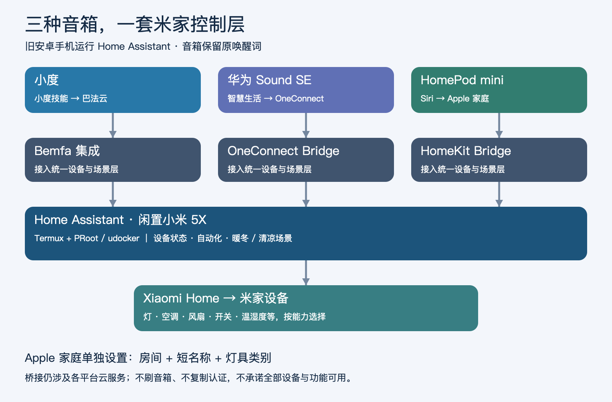
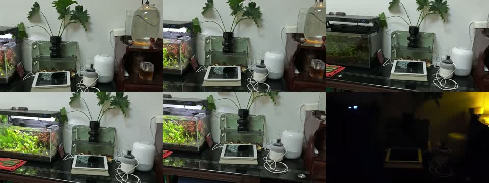

# 一台闲置小米 5X，让小度、华为 Sound SE 和 HomePod mini 都能控制米家

发表于知乎：https://zhuanlan.zhihu.com/p/2102867147277996560

## 从刷机念头，到三平台联动

我最初只是想做一件小事：把家里的小度智能音箱刷成小爱同学，用它控制米家设备。

折腾到最后，小度没有刷机，安卓手机也没有换系统。我用一台闲置小米 5X 跑起了 Home Assistant，把小度、华为 Sound SE、HomePod mini 三条语音链路都接到了同一批米家设备上。

最后一个让我觉得“这东西终于能日常用了”的测试，是对书房里的 HomePod 说：“嘿 Siri，关闭客厅所有的灯。”客厅吸顶灯、氛围灯和鱼缸灯一起关闭，书房和卧室的灯保持原状。

这篇文章把完整过程写下来：为什么放弃刷机、旧手机怎样承担桥接、三个平台分别怎么接、哪些地方真的踩了坑，以及怎样把经验整理给 Agent 复现。项目已经公开，代码和文档链接放在文末。

## 一、先把做到了什么说清楚

这次实际使用的设备包括：小度 XDH-01-A1、华为 Sound SE、HomePod mini，以及作为常开主机的小米 5X。米家只导入了一个家庭，共 24 台源设备。

目前已经通过实物或状态验证的结果是：

- 小度：虚拟开关开关成功，客厅吸顶灯控制成功，客厅湿度查询正确。
- 华为 Sound SE：虚拟开关与客厅真实灯控制成功；“打开暖冬”能触发客厅空调制热 28℃。
- HomePod mini：虚拟开关与真实灯控制成功；按房间关闭客厅三盏灯成功，而且没有影响其他房间。
- 旧手机：Home Assistant 局域网访问可用，早期桥接配置的手机重启自启已验证。

也有明确的未验证项：华为的“清凉”场景已配置为制冷 26℃，但没有为测试而启动空调；批量导入的配件没有逐一做实物验收；新增平台后的完整整机重启和长期稳定性，还需要继续观察。

这里的“24 台设备”“28 个 HomeKit 实体”和“语音入口数量”不是一个概念。一台空调可能同时有电源、温度、模式等多个属性，不能拿实体数量当作支持了多少台独立设备。

## 二、为什么没有继续把小度刷成小爱

最开始确实检查过小度的硬件。底部小板上能看到 GND、RX、TX 标记，TX 相对 GND 的测量电压约为 3.27V，具备继续研究串口的线索。

但找到串口，距离“变成一台能绑定米家的小爱音箱”，中间还隔着很长一段路。

需要解决的可能包括启动链、固件适配、音频驱动、麦克风阵列、唤醒与语音服务，以及云端设备身份和授权。读到日志、获得命令行、能写入固件，都不能单独证明最终能正常使用小爱服务。

在这次排查中，我没有拿到经过验证、可以直接刷进这台小度并正常绑定米家的小爱固件。因此没有继续把“可刷机”当成目标，也没有复制另一台小爱音箱的设备身份。

我真正需要的是用现有音箱控制米家。把这件事拆出来后，桥接就成了更清晰的路线。

## 三、系统怎么连接：HA 负责统一设备，音箱负责接收语音

三条链路分别是：

小度 → 小度平台的巴法技能 → 巴法云 → Home Assistant 的 Bemfa 集成 → Xiaomi Home → 米家设备。

华为 Sound SE → 华为智慧生活／小艺 → OneConnect Bridge → Home Assistant → Xiaomi Home → 米家设备。

HomePod mini／Siri → Apple 家庭 → HomeKit Bridge → Home Assistant → Xiaomi Home → 米家设备。

三种音箱都保留自己的唤醒词。小度还是“小度小度”，华为还是“小艺小艺”，HomePod 还是 Siri。它们不是被刷成同一种音箱，而是各自的控制指令最终汇到同一套设备层。

HomeKit Bridge 与手机 HA 之间可以走局域网，但整套方案不能因此被称为“全本地”。小米接入、各平台语音识别，以及小度、华为的桥接链路，仍涉及对应云服务。断网后哪些功能可用，要分链路测试，不能一概而论。

## 四、闲置小米 5X 怎样变成 HA 主机

我没有 NAS 或长期运行的小主机，手边有闲置安卓手机，于是选择了小米 5X。

实际环境是 Android 8.1、无 root，安装 Termux 和 Termux:Boot，再通过 PRoot／udocker 运行 ARM64 的 Home Assistant。此次基线是 HA 2026.11.0，具体版本与社区组件版本已记录在仓库。

Termux 是一个安卓应用，不是覆盖安卓的完整系统。原来的手机系统仍然保留。Termux:Boot 是另一个配套应用，负责在开机后执行启动脚本。

部署过程大体分为四步：

1. 安装来源一致、签名兼容的 Termux 与 Termux:Boot，首次打开 Boot 完成初始化。
2. 在 Termux 中准备 Python、PRoot、udocker 等运行环境，获取官方 ARM64 HA 镜像。
3. 创建持久化 config 目录，设置临时目录、共享内存目录与实际可用的 DNS，启动 HA。
4. 打开网页创建自己的账户，配置后台不限制、自启动和开机脚本，再验证局域网访问。

手机路线比标准 Linux 多一些适配工作。Android 对网络接口、进程和后台运行的限制，与普通服务器不同，不能把一条 Docker 命令复制过去就认为完成了。仓库保存了启动、停止和重启监督脚本，但没有把原设备的环境包装成“所有手机一键成功”的安装器。

如果你本来就有 NAS、小主机或 HAOS，优先用现成主机更省维护。旧手机的价值在于复用手边设备，不是说它比专用主机更可靠。

日常运行时，手机需要持续开机、联网并保持 Termux 后台存活，不必一直连接电脑。还要关注充电、电池温度和长期使用状态。配置完成后至少测试一次服务重启和手机重启，分别检查网页、桥接和真实设备控制是否恢复。

## 五、先接米家，再接音箱：只导入一个家庭

米家接入使用 Xiaomi Home 集成，通过官方授权流程登录自己的账号。

这一步容易犯的错，是一口气把所有家庭、所有设备都导进来。我这次也遇到过大量设备导入后负担明显增加，最终只保留实际使用的那个家庭。

另一个容易忽视的问题是命名。设备名称、设备所在房间、HA 实体名称和语音平台显示名称，可能不是同一个字段。一个普通灯，最后可能变成“某某的家 客厅 客厅吸顶灯 开关 开关”。网页能点，不代表语音容易匹配。

我最终使用短房间名：客厅、主卧、次卧、书房。设备名称尽量表达用途，并避免重复的“开关”后缀。

先在 HA 中确认源设备可控，再继续接语音平台。如果 HA 里源实体已经 unavailable，桥接不会凭空让它恢复在线。

## 六、小度：最有价值的第一步，是做一个不会控制电器的测试开关

小度这条路线通过巴法云连接。

我先创建了一个 HA 虚拟开关，命名为“桥接测试”。它不会接通真实电器，只用于验证完整链路。

在小度 App 绑定同一个巴法账号后，分别说“打开桥接测试”“关闭桥接测试”，同时检查 HA 状态是否真的变化。两次通过后，再接入一盏真实灯。

第一次接入客厅灯时，小度 App 手动操作是正常的，但音箱回答“没有找到可以控制的设备”。后来把冗长名字暂时改为“测试灯”，语音就成功了，最后再改回“客厅吸顶灯”。

这件事说明：排查要分层。App 能控制但语音找不到，优先检查名称、房间和语音匹配，不必立刻怀疑设备协议。

### 湿度为什么会读成零，甚至把鱼缸也读出来？

另一个坑是温湿度传感器。HA 原始湿度正常，云端也能收到数值，但小度语音最初会回答零。

这次的解决方式，是在 Bemfa 传感器同步逻辑里，把同一房间的温度与湿度配对发布，保留一个对应的主题，并移除重复的湿度入口。这样语音平台才不至于把一个只有温度、另一个只有湿度的入口错误理解成两个不完整的温湿度设备。

随后又碰到“问客厅湿度，却把漏水状态、鱼缸水温也回答出来”。这些数据虽然都在 HA，但不适合混进同一种通用温湿度语音入口。最终把它们从小度的这一类入口中移出，数据本身仍保留在 HA。

因此，设备导入越多不等于体验越好。要让每个语音入口语义明确。

## 七、华为 Sound SE：基本开关打通后，空调模式需要另一层处理

华为这边使用社区 OneConnect Bridge，并完成智慧生活的正常配对。这个项目不是华为官方提供的米家互联服务。

旧手机环境有一个实际问题：组件读取不到 Android Wi-Fi 网卡的真实 MAC。因此增加了手动输入本机 MAC 的适配；同时针对基本空调电源、扫地机指令和配对动作描述做了本地修改。补丁与对应上游 commit 已放进仓库，升级时可以检查差异。

配对过程仍走正常的 PIN 与授权流程，没有跳过证书验证，也没有伪造别人的云端设备身份。PIN 超时后重新开启配对窗口，不要反复输入过期码。

验证顺序与小度一样：先“联动测试”虚拟开关，再客厅吸顶灯，最后批量导入。虚拟开关和真实灯都由实际语音测试通过。

### “打开客厅制热”为什么失败，“打开暖冬”却成功？

在这套 Huawei 映射中，普通空调入口先只实现电源开关，不能直接等同于完整的原生空调模式控制。

我的需求很明确：客厅制热默认 28℃，制冷默认 26℃。于是 HA 中建立两个场景，把空调模式和目标温度一起设置，再把场景以瞬时开关的形式暴露出去。

最初场景叫“客厅制热”“客厅制冷”。说“打开客厅制热”时，小艺回答找不到可以制热或制冷的设备；HA 里也没有场景被触发。

把名称改成“暖冬”“清凉”之后，“打开暖冬”成功了。这个对照更像是语音意图冲突：小艺优先把“制热”识别成原生空调命令，没有走我们创建的开关入口。

最终使用的口令是：

- “小艺小艺，打开暖冬”：客厅空调制热 28℃，已验证。
- “小艺小艺，打开清凉”：客厅空调制冷 26℃，已配置，未实测。
- “小艺小艺，关闭客厅空调电源”：关闭空调。

关闭“暖冬”这个场景开关不等于关闭空调，场景和设备电源是两回事。

## 八、HomePod mini：配对成功以后，真正的工作才刚开始

HomePod 走 HA 自带的 HomeKit Bridge。注意名字：这是把 HA 设备提供给 Apple 家庭的桥接，不是反过来导入 HomeKit 设备的 HomeKit Device，也不是把 HomePod 作为媒体播放器加入 HA。

我先只选择虚拟开关这一类实体。HA 通知里出现配对二维码后，用已经加入 HomePod 所在家庭的 iPhone，在“家庭”App 中添加配件。Siri 的测试开关通过以后，再扩展为明确选择的 28 个实体。

采用白名单很重要。不要把 HA 的所有域全选，否则指示灯、重复属性、辅助开关可能一下子把家庭 App 塞满。

随后出现了最影响体验的问题：配件都能看见，但全部堆在同一个房间。要控制某个设备，几乎必须把完整名字准确说出来。

原因是：HA 里的区域，不会自动变成 Apple 家庭里的房间。它们需要分别整理。

### 三件事必须一起做：房间、名称、类别

我在 Apple 家庭中建立了客厅、主卧、次卧、书房，把设备移到真实位置，然后使用短名称：

- 客厅：吸顶灯、氛围灯、鱼缸灯、空调、温度、湿度。
- 主卧：吸顶灯、空调、风扇、电暖气、温度、湿度。
- 次卧：吸顶灯、空调。
- 书房：HomePod、吸顶灯、空调。

HomePod 实际放在书房，因此也必须移到书房。它自己的房间归属会影响没有明确房间限定时的语音理解。

还有一个关键细节：四盏房间主灯在 HA 中其实是 switch 实体。刚桥接到 Apple 家庭时，它们显示为“开关”。只把名字改成“吸顶灯”，不代表 Siri 会把它们算进“所有的灯”。

在配件设置里把“显示为”改成“灯”，再确认它们出现在相应房间的灯具类别中，这一步才算完成。

最后实测“关闭客厅所有的灯”，客厅的吸顶灯、氛围灯、鱼缸灯全部关闭，其他房间不变。这个测试同时验证了设备类型、房间、语音匹配和实际控制链路。

如果不希望“关客厅所有灯”影响鱼缸灯，可以另外做只控制吸顶灯和氛围灯的场景。不能一边把鱼缸灯放进客厅灯具类别，一边指望“所有灯”自动排除它。

### Mac 和 iPhone 不是同一个 Apple 账号怎么办？

这次电脑用的 Apple 账号与 iPhone 不同，所以 Mac 一开始看不到同一个家庭。

不用退出 Mac 的账号。可以由家庭所有者在 iPhone 的家庭设置中邀请 Mac 的 Apple 账户，Mac 在家庭 App 的邀请入口接受，再由所有者授予添加和编辑配件权限。这会给受邀账号家庭访问权，只应邀请自己信任的账号。

这不是系统设置中的“家人共享”，也不用去普通邮件里寻找唯一的接收入口。接受后，我就能在 Mac 上完成上述房间、名称与类别整理。

## 九、让 Agent 帮忙，应该怎样给任务？

这次部署有很大一部分是在 Agent 协助下完成的：检查网络、安装组件、写适配、读取日志、修改配置，以及操作网页和家庭 App。登录授权、扫码、实物确认仍由我完成。

真正有用的任务描述，不是“把家里全自动弄好”，而是把成功标准拆开：

“先确认 HA 能看到一个真实设备；再创建一个虚拟开关验证语音链路；然后接一盏灯；最后分批扩展。配置保存、云端注册、语音回复和实物变化要分别记录。不要把我的账号令牌、配对码和整机备份提交到 GitHub。”

我把完整的复现 prompt、AGENTS.md、运行脚本、兼容补丁、配置例子、HomeKit 房间指南和已知问题整理进了项目。

别人 clone 后可以把目录交给有终端与设备操作能力的 Agent，从文档开始复现。它仍需要使用者自己的账户、自己的实体 ID、自己的局域网与配对过程。不能复制我家的设备身份，也不能保证任何一款旧手机都无需适配。

## 十、这套方案适合谁，还有哪些边界？

如果已经有几个不同品牌的智能音箱，又主要使用米家设备，愿意维护一个常开 HA 主机，这种桥接值得尝试。尤其是有闲置手机或现成小主机时，可以先用一盏灯验证，再决定是否扩大范围。

但我不会把它推荐成“装完永远不用管”的家电式方案。社区组件、云接口、设备状态、手机后台策略和名称同步，都可能影响体验。

需要保留私有备份，升级组件前核对补丁。HomeKit 配对状态和密钥不能随手删除；包含登录凭据的 HA .storage、数据库、日志、二维码也不要公开上传。

最后再列清楚没有做的事：没有把小度刷成小爱，没有改唤醒词，没有复制设备认证；也没有把免费音乐、任意歌名点播或 Sound SE 的 DLNA 音乐投放包装成已经实现的功能。

目前真正跑通的是：让不同平台的语音入口，通过同一个 HA 设备层控制米家，并把房间和名称整理到能日常使用的程度。

## 实拍与复现资料

[观看原始实拍视频](https://github.com/muziyongshixin/smart-speaker-ha-bridge/blob/main/docs/media/demo.mp4)

仓库里附有约 22 秒的原始家庭设备演示视频与预览图。视频是补充演示，不意味着本文所有测试都在同一段视频中出现；实测范围以上文逐项记录为准。

官方与上游资料：
HomeKit Bridge：https://www.home-assistant.io/integrations/homekit/
Apple 家庭共享：https://support.apple.com/zh-cn/102386
Xiaomi Home：https://github.com/XiaoMi/ha_xiaomi_home
Bemfa Cloud：https://github.com/bemfa/bemfa_cloud_ha
OneConnect Bridge：https://github.com/chaosl1996/ha-oneconnect-bridge

本文根据本人实际部署、操作记录与实物验证整理，使用 AI 辅助撰写和编辑。记录日期为 2026 年 11 月 8 日，后续变更以仓库为准。

GitHub 项目（已补充 HomePod mini、房间整理和分房间关灯验证）：
https://github.com/muziyongshixin/smart-speaker-ha-bridge
